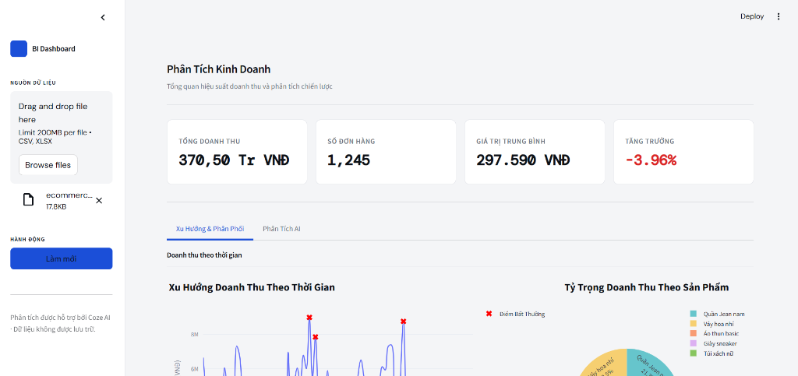
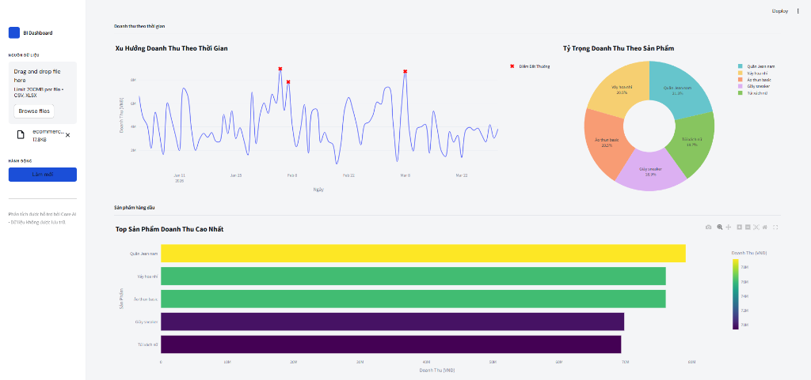
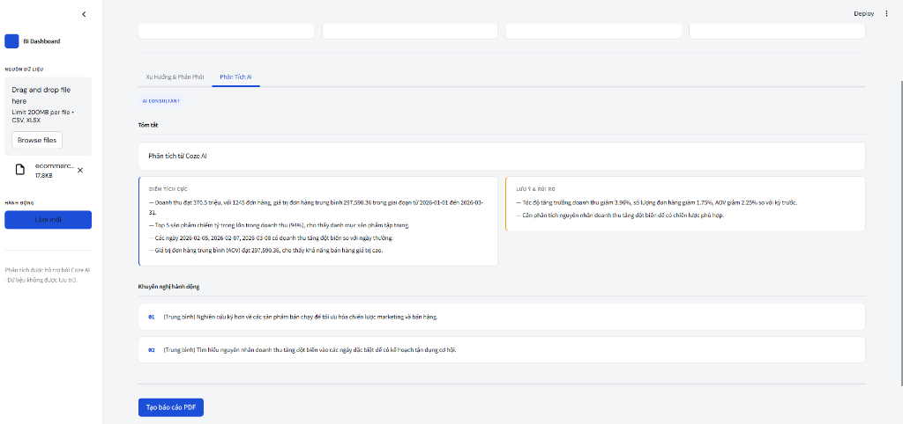

# 📊 AI Business Insight Dashboard

 *(Chèn ảnh chụp toàn cảnh Dashboard vào đây)*

Một nền tảng Báo cáo Phân tích Kinh doanh (Business Intelligence Dashboard) cấp doanh nghiệp, được hỗ trợ bởi Trí tuệ nhân tạo (AI). Hệ thống này tiếp nhận dữ liệu bán hàng thô (file CSV/Excel), tự động làm sạch, tính toán các chỉ số kinh doanh chuyên sâu (AOV, Tỷ lệ tăng trưởng, Phát hiện bất thường qua Z-Score) và sử dụng **Coze AI (Claude/GPT-4o)** đóng vai trò như một chuyên gia phân tích dữ liệu tự động. Hệ thống sẽ cung cấp các insight (nhận xét) có giá trị thực tiễn và tự động xuất báo cáo dưới dạng PDF.

## ✨ Tính năng nổi bật

- **Tự động hóa luồng dữ liệu (Data Pipeline)**: Xử lý mạnh mẽ các file Excel/CSV chứa nhiều dữ liệu "rác", làm sạch các cột `revenue` (doanh thu) và `orders` (đơn hàng) bằng RegEx.
- **Tính toán chỉ số chuyên sâu**: Tự động tính toán Tỷ lệ tăng trưởng (MoM), Giá trị đơn hàng trung bình (AOV), Doanh thu trên mỗi đơn, và Phát hiện ngày có doanh thu bất thường dựa trên Z-Score.
- **Giao diện Enterprise SaaS**: Dashboard cực kì gọn gàng, đáp ứng tốt trên mọi thiết bị và mang phong cách thiết kế B2B chuyên nghiệp, xây dựng bằng Streamlit với CSS tùy chỉnh (Ép Light Mode, phông chữ DM Sans/Mono).
- **Chuyên gia phân tích AI (AI Consultant)**: Tích hợp API của Coze để "đọc hiểu" dữ liệu số học và tạo ra các nhận xét dễ hiểu cho con người (Tóm tắt, Điểm sáng, Cảnh báo rủi ro và Đề xuất ưu tiên).
- **Trình bóc tách văn bản thông minh (Text Parser)**: Tích hợp khả năng chống lỗi (Fault-tolerant) cực tốt. Ngay cả khi AI không trả về định dạng JSON, hệ thống vẫn tự động bóc tách được các phần văn bản để hiển thị lên Dashboard một cách hoàn hảo.
- **Tự động xuất báo cáo PDF**: Tạo báo cáo PDF theo chuẩn định dạng tiếng Việt nhờ việc nhúng trực tiếp phông chữ Arial của hệ thống.

## 📸 Ảnh minh họa

### 1. Phân tích Xu hướng & KPI
 *(Chèn ảnh chụp khu vực KPI và Biểu đồ vào đây)*

### 2. Góc nhìn từ Chuyên gia AI (AI Insights)
 *(Chèn ảnh chụp phần Nhận xét của AI vào đây)*

## 🛠️ Công nghệ sử dụng

- **Frontend/Giao diện**: Streamlit (với CSS Custom phong cách Doanh nghiệp & Plotly để vẽ biểu đồ)
- **Xử lý Dữ liệu**: Pandas, NumPy
- **Tích hợp AI**: Coze API (`requests`), Bộ phân tách Text-to-JSON tự phát triển
- **Xuất PDF**: ReportLab (Hỗ trợ nhúng phông chữ Arial để tránh lỗi font tiếng Việt)

## 📁 Cấu trúc Dự án

```text
📦 AI_Business_Dashboard
 ┣ 📂 app/
 ┃ ┣ 📜 ai_engine.py      # Tích hợp API Coze & Bộ xử lý lỗi định dạng
 ┃ ┣ 📜 metrics.py        # Đóng gói dữ liệu chỉ số gửi cho AI
 ┃ ┣ 📜 processor.py      # Các hàm tính toán (Z-Score, AOV, Tăng trưởng)
 ┃ ┣ 📜 reporter.py       # Tạo file PDF báo cáo (hỗ trợ Tiếng Việt)
 ┃ ┣ 📜 validator.py      # Luồng làm sạch và chuẩn hóa dữ liệu đầu vào
 ┃ ┗ 📜 visualizer.py     # Code vẽ biểu đồ Plotly
 ┣ 📂 .streamlit/
 ┃ ┗ 📜 config.toml       # Ép chế độ giao diện Sáng (Light Theme) cho Streamlit
 ┣ 📜 streamlit_app.py    # File chạy chính của Dashboard UI
 ┣ 📜 requirements.txt    # Danh sách thư viện Python cần thiết
 ┣ 📜 .env                # File biến môi trường (Chứa API Keys)
 ┗ 📜 README.md
```

## 🚀 Hướng dẫn Cài đặt & Sử dụng

### 1. Clone repository về máy
```bash
git clone https://github.com/ddkhoa2605/Report_generator.git
cd Report_generator
```

### 2. Cài đặt các thư viện cần thiết
```bash
pip install -r requirements.txt
```

### 3. Cấu hình Biến môi trường
Tạo một file `.env` tại thư mục gốc của dự án và điền thông tin Bot Coze của bạn vào:
```env
COZE_API_KEY="điền_personal_access_token_của_bạn_vào_đây"
COZE_BOT_ID="điền_bot_id_của_bạn_vào_đây"
```

### 4. Khởi chạy Dashboard
```bash
streamlit run streamlit_app.py
```
*(Giao diện điều khiển sẽ tự động mở tại địa chỉ `http://localhost:8501`)*

## 🤖 Hướng dẫn thiết lập Prompt cho Coze Bot
Để AI hoạt động hoàn hảo nhất, hãy sao chép đoạn System Prompt dưới đây và dán vào phần cài đặt Bot trên Coze:
```text
Bạn là chuyên gia phân tích kinh doanh tại Việt Nam.
Dựa trên dữ liệu metrics được cung cấp dạng JSON, hãy:
- Viết 1 câu tóm tắt
- Phát hiện các điểm sáng (Insights)
- Chỉ ra rủi ro/vấn đề (Warnings)
- Đưa ra đề xuất hành động (Recommendations)
Không giải thích thêm.
```

## 📄 Bản quyền
Dự án này được tạo ra nhằm mục đích giáo dục và xây dựng Portfolio cá nhân.

---
**Được phát triển bởi**: Khoa (ddkhoa2605)
